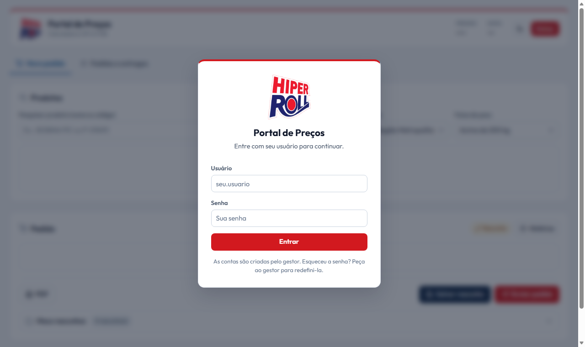
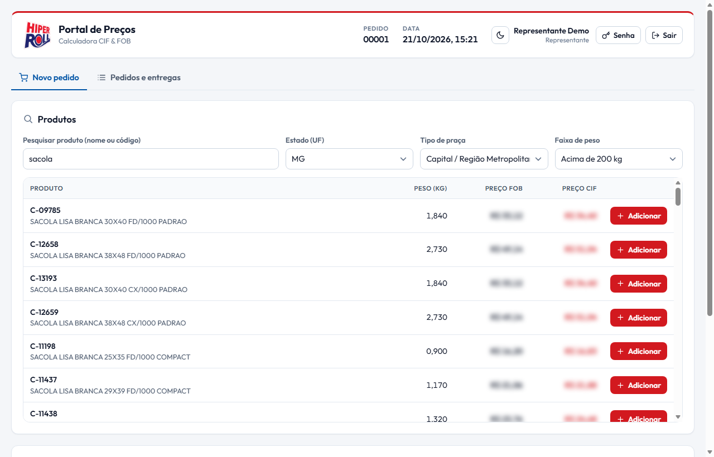
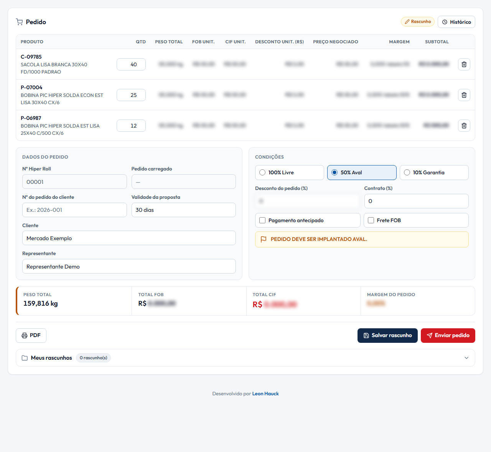
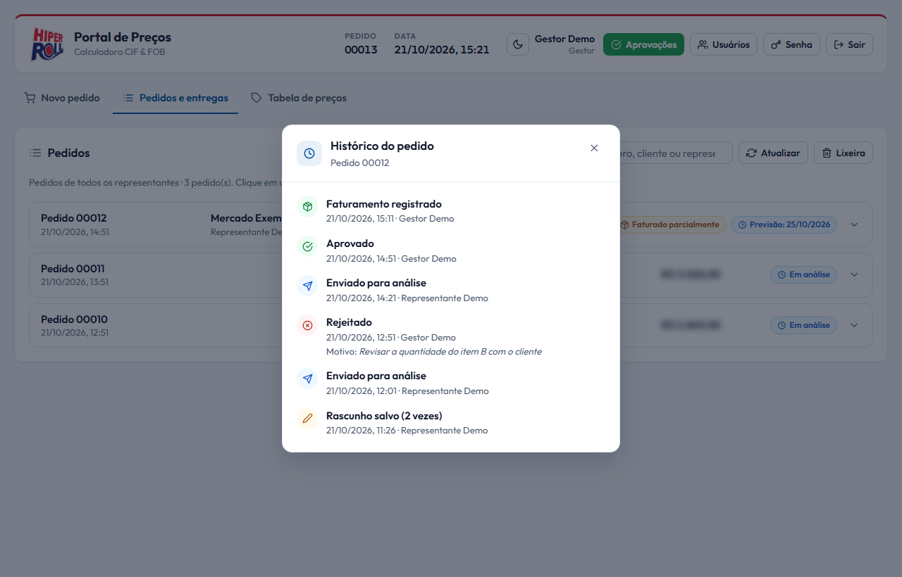
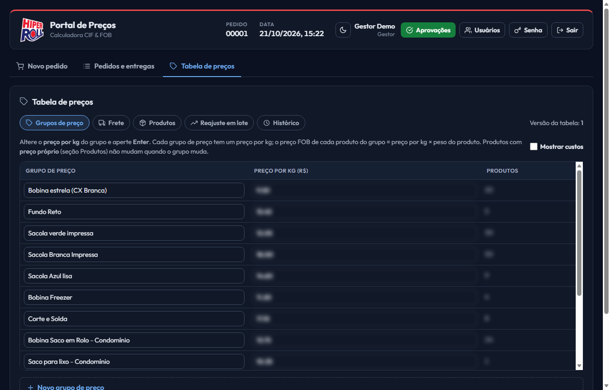
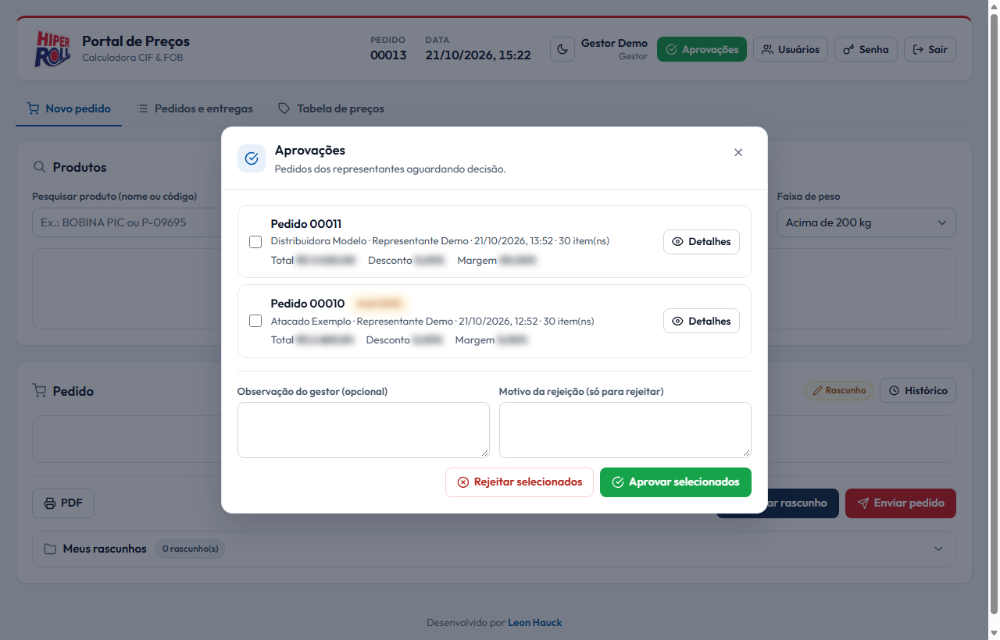
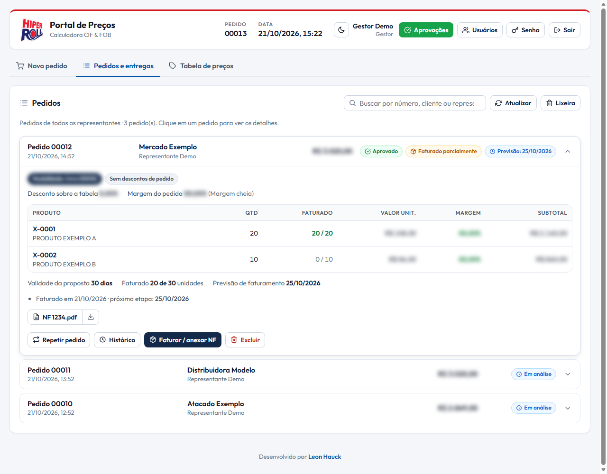
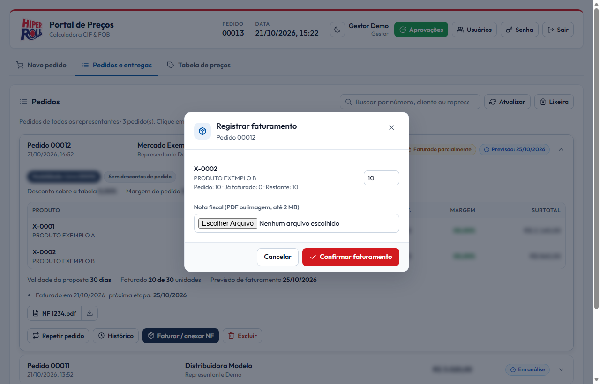
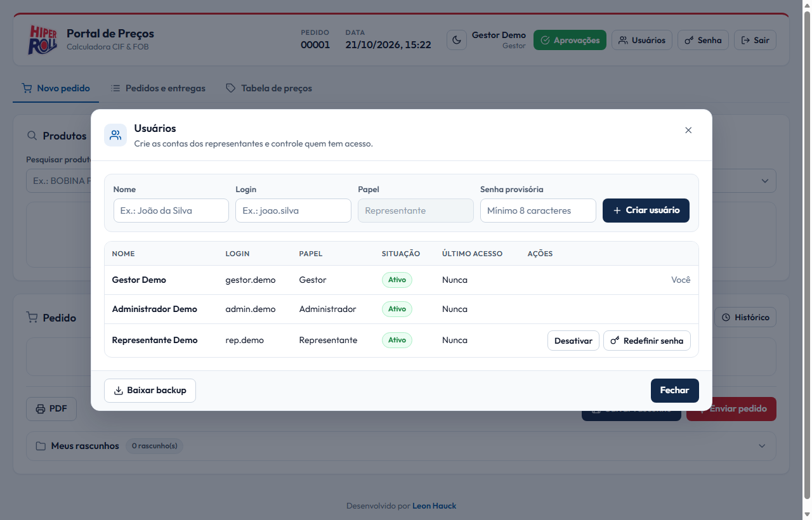

<div align="center">
  
  <h1>Portal de Preços Hiperroll</h1>
  <p><strong>Precificação CIF/FOB, negociação comercial e aprovação de pedidos</strong></p>
  <p>
    
    
    
    
    
  </p>
</div>

## 📋 Visão Geral

O Portal de Preços Hiperroll é uma aplicação web para apoiar a equipe comercial na formação de preços, montagem de pedidos e negociação com clientes. A aplicação cruza produtos, custos, pesos e regras de frete para calcular valores **FOB** e **CIF** conforme o estado, o tipo de praça e a faixa de peso selecionados.

Além da calculadora, o portal oferece um fluxo de negociação com preço unitário editável, descontos, contratos, acompanhamento de margem, rascunhos, envio para análise, aprovação ou rejeição por usuários autorizados e exportação de pedidos em PDF.

## 🖼️ Telas do sistema

Capturas feitas com usuários e clientes de exemplo. Preços, descontos e margens foram trocados por zeros e desfocados. As imagens são geradas por `tests/gerar_prints.ps1`.

| Login | Consulta de preços |
| :---: | :---: |
|  |  |
| Cada pessoa entra com o próprio usuário. | Produto, estado, tipo de praça e faixa de peso definem o preço. |

| Montagem do pedido | Histórico do pedido |
| :---: | :---: |
|  |  |
| Itens, preço negociado, condições e margem em tempo real. | Quem salvou, enviou, aprovou, rejeitou e faturou, com data e hora. |

| Tabela de preços (tema escuro) |
| :---: |
|  |
| O gestor altera preços, fretes e produtos direto na tela. |

| Aprovações (gestor) | Histórico e entregas |
| :---: | :---: |
|  |  |
| Pedidos aguardando decisão, com observação e motivo da rejeição. | Situação, faturamento parcial e previsão da próxima entrega. |

| Registrar faturamento | Usuários |
| :---: | :---: |
|  |  |
| Quantidade faturada por item e nota fiscal anexada. | O gestor cria contas, desativa e redefine senhas. |

## ⚙️ Funcionalidades

### 💰 Precificação

- Pesquisa de produtos por descrição, código e categoria.
- Seleção de UF, tipo de praça e faixa de peso.
- Cálculo dos preços **FOB** e **CIF** de cada produto a partir da tabela de preços, do peso e do frete da região.
- Exibição de peso, preço FOB e preço CIF por item.
- **💲 Tabela de Preços (aba do gestor):** custos e preço por kg de cada **grupo de preço** (a "linha de produto" da planilha de custos), tabela de frete, cadastro de produtos (grupo, peso, ativo/inativo), **preço próprio por produto**, ações por **categoria** (reajuste %, mover de grupo, voltar ao preço do grupo), reajuste percentual em lote com pré-visualização e histórico "de → para" de cada alteração. Mudanças valem imediatamente para todos.
- **Vocabulário:** *categoria* é a família do produto (serve para filtrar); *grupo de preço* é o conjunto de produtos que compartilha um preço por kg. No código, grupo de preço aparece como `costLines` / `cost_lines`.
- **Atualização automática:** cada portal aberto confere a versão da tabela a cada minuto (e ao voltar para a aba do navegador); se o gestor mudou algo, a busca e o pedido aberto se atualizam sozinhos.

### 🤝 Negociação e margem

- Inclusão de produtos em um pedido com quantidade ajustável.
- Alteração do preço negociado por item, com sincronização entre preço negociado e desconto unitário.
- Condições comerciais do pedido: modalidade, desconto, contrato, forma de pagamento e frete.
- Acompanhamento em tempo real do desconto sobre a tabela e da margem, por item e por pedido.
- Avisos automáticos conforme a modalidade escolhida, exibidos ao representante e ao gestor.
- Pedidos fora da política comercial só são enviados com justificativa e chegam sinalizados ao gestor.
- **Preços atualizados:** ao abrir um rascunho, repetir um pedido ou enviar depois que o gestor mudou a tabela, o portal mostra o que mudou e o representante escolhe entre manter os preços negociados ou aplicar a nova tabela.

Os percentuais, limites e margens da política comercial não são descritos neste README.

### 🧾 Pedidos e workflow comercial

- Geração automática do número interno Hiperroll com cinco dígitos.
- Registro de cliente, representante, validade da proposta e número do pedido do cliente.
- Salvamento e carregamento de rascunhos.
- Envio de pedidos para o status **Em Análise**.
- **Histórico do pedido** (botão "📋 Histórico" no resumo do pedido e em cada cartão da aba Histórico e Entregas): rascunho salvo, envio, aprovação ou rejeição com o motivo, faturamento, lixeira e restauração, com data e usuário. Vem do registro de auditoria do servidor, então o representante e o gestor veem a mesma linha do tempo em qualquer computador.
- Consulta dos pedidos do usuário na aba **Histórico e Entregas**.
- Aprovação ou rejeição com justificativa e observação do supervisor.
- Previsão de faturamento calculada após a aprovação.
- Exclusão de registros armazenados localmente quando necessário.

### 🖨️ Exportação

- Geração de proposta comercial em PDF com os dados do pedido, itens, valores, descontos, contrato e margem.
- Exportação controlada pelo `html2pdf.js`, carregado via CDN no HTML principal.

## 🎨 Interface e experiência

- **🌓 Tema claro e escuro:** botão dedicado no cabeçalho para alternar o tema; a escolha é salva no navegador e, no primeiro acesso, o portal detecta automaticamente a preferência do sistema operacional.
- **🏷️ Identidade visual da Hiperroll:** cabeçalho com o logo oficial em destaque sobre um degradê nas cores da marca (vermelho → azul-marinho), reaproveitado também na tela de login.
- **🧩 Painéis padronizados:** os modais de Supervisor, Lixeira, Faturamento, Detalhes do Pedido, Histórico do Pedido e Envio de Pedido seguem o mesmo padrão visual (cabeçalho com ícone, corpo rolável e rodapé de ações).
- **🔘 Botões com hierarquia clara:** a ação principal de cada tela (como "Enviar Pedido ao Sistema") se destaca visualmente das ações secundárias (PDF, Salvar Rascunho, Ver Meus Pedidos).
- **🖼️ Ícone da aba (favicon)** com o logo da Hiperroll e rodapé com crédito de desenvolvimento.

## 👥 Perfis e permissões

Cada representante tem o próprio login. As permissões são verificadas **no servidor** a cada ação; a tela apenas esconde o que o usuário não pode usar.

| Ação | Representante | Gestor | Administrador técnico |
|---|---|---|---|
| Criar rascunhos e enviar os próprios pedidos | ✓ | ✓ | ✓ |
| Ver pedidos | só os próprios | **todos** | só os próprios |
| Aprovar, rejeitar e registrar faturamento | — | **✓ (exclusivo)** | — |
| Lixeira | dos próprios pedidos | de todos | dos próprios pedidos |
| Excluir definitivamente | só rascunhos/rejeitados próprios | qualquer pedido | só rascunhos/rejeitados próprios |
| Criar, desativar e redefinir senha de usuários | — | representantes | todas as contas |
| Baixar backup | — | ✓ | ✓ |
| Tabela de Preços (custos, frete, produtos, reajuste) | — | **✓ (edita)** | importa e consulta |

- Contas novas recebem uma **senha provisória**; no primeiro acesso o sistema obriga a criação de uma senha pessoal.
- O sistema impede desativar o último gestor ativo.

## 🚀 Como executar localmente

O portal agora depende do backend PHP (login, pedidos compartilhados e tabelas de preço). Abrir o HTML direto pelo Windows (`file://`) mostra apenas a tela de login com erro de conexão.

Com PHP 8+ instalado, na pasta do projeto:

```powershell
php -S localhost:8000
```

1. Acesse `http://localhost:8000/setup.php` e crie as contas do gestor e do administrador.
2. Depois use `http://localhost:8000/Portal_Hiperroll_Final.html`.

### 🎬 Sem PHP: modo demonstração

A pasta `demo/` fica só na máquina de desenvolvimento (está no `.gitignore`, não vai para o repositório). Para ver e apresentar o sistema sem servidor, abra **`demo/index.html`** com dois cliques. O arquivo `demo/demo_api.js` simula a API dentro do navegador com as mesmas regras do PHP (papéis, modalidades e limites de desconto, versão da tabela de preços, histórico).

- A barra no canto inferior troca de usuário (gestor, administrador, representantes) e tem o botão **Zerar dados**. As contas de exemplo aceitam qualquer senha.
- Os dados ficam só no `localStorage` daquele navegador; nada é enviado a lugar nenhum.
- A demonstração **não testa o PHP** e não é segurança de verdade: serve para navegar, treinar e apresentar.
- `demo/index.html` é gerado a partir do HTML principal. Depois de mudar o `Portal_Hiperroll_Final.html`, rode `powershell -File demo\gerar_demo.ps1`.
- A pasta `demo/` não deve ser enviada para a hospedagem (e o `.htaccess` dela bloqueia o acesso se for).

## ☁️ Publicação na HostGator

1. **PHP:** em cPanel → *MultiPHP Manager*, selecione PHP 8.1 ou superior. Em *Select PHP Version → Extensions*, confirme `pdo_sqlite` e `mbstring` marcados.
2. **SSL:** em cPanel → *SSL/TLS Status*, ative o AutoSSL (gratuito). Depois descomente o bloco "forçar HTTPS" no `.htaccess` da raiz.
3. **Arquivos:** envie para uma pasta do `public_html` (ex.: `public_html/portal/`) somente o necessário:
   `Portal_Hiperroll_Final.html`, `style.css`, `data.js`, `setup.php`, `.htaccess`, `logo.png`, `logo-hiperroll.png`, `logo-transparent.png` e as pastas `js/`, `api/` e `data/`.
   O **`data.js` não está no repositório** (ele tem custos, fretes, preços e margens): copie-o da sua máquina para o servidor. O mesmo vale para **`api/regras_comerciais.php`** (limites de desconto e percentuais): envie o da sua máquina para a pasta `api/` do servidor. Sem ele o portal não calcula pedidos e o `setup.php` avisa. Depois que o gestor abre a aba Tabela de Preços pela primeira vez, a tabela passa para o banco e o `data.js` pode até ser apagado do servidor.
   Não é preciso enviar a planilha, as pastas `tests/`, `docs/`, `demo/`, `scratch/` e `arquivo_planilhas/` (planilhas antigas, só locais), nem o `README.md` (o `.htaccess` bloqueia o download deles caso sejam enviados).
4. **Banco fora da pasta pública (recomendado):** copie `api/config.local.example.php` para `api/config.local.php` e aponte `db_path` para algo como `/home/SEU_USUARIO/portal_data/portal.sqlite`.
5. **Primeiro acesso:** abra `https://seudominio.com.br/portal/setup.php`, confira a verificação do servidor e crie as contas do gestor e do administrador. A página se desativa sozinha depois disso.
6. **Representantes:** o gestor entra no portal → **👥 Usuários** → cria cada representante com uma senha provisória.

## 💾 Dados e persistência

- Usuários, pedidos, lixeira, numeração Hiper Roll e o registro de auditoria ficam em um banco **SQLite** (um único arquivo, `data/portal.sqlite` por padrão), criado automaticamente pelo PHP.
- O número Hiper Roll é gerado pelo servidor quando o pedido é salvo pela primeira vez, então dois representantes nunca recebem o mesmo número. O número exibido em um pedido ainda não salvo é uma previsão.
- **Notas fiscais anexadas:** cada nota (PDF, PNG, JPG, WEBP ou GIF, até 2 MB) é gravada como arquivo na pasta `invoices/`, ao lado do banco (`data/invoices/` por padrão; acompanha o `db_path`). O pedido guarda só nome, tipo, tamanho e data, então listar pedidos não carrega os arquivos. No pedido, "📄 nome" abre a nota em outra aba e "⬇️" baixa; os dois passam pela API (`orders.invoice`), que só entrega o arquivo ao representante dono do pedido ou ao gestor. O tipo é conferido pelo conteúdo do arquivo, não pelo nome. Os arquivos são apagados quando o pedido é excluído definitivamente ou restaurado da lixeira como rascunho.
- **Backup:** gestor ou administrador → **👥 Usuários → ⬇️ Baixar backup** (arquivo JSON com pedidos, as notas fiscais anexadas e usuários, sem as senhas). Para uma cópia completa, baixe o arquivo `.sqlite` e a pasta `invoices/` pelo Gerenciador de Arquivos do cPanel; para restaurar, basta substituí-los.
- **Tabela de preços:** na primeira vez que o gestor (ou o administrador) abre a aba 💲 Tabela de Preços, a tabela do `data.js` é copiada para o banco automaticamente, sem mudar nenhum preço. A partir daí, grupos de preço, frete, produtos e o histórico de preços ficam no mesmo banco SQLite, com um número de versão que sobe a cada alteração e é gravado em cada pedido.
- Até essa primeira abertura, o portal usa o `data.js`, entregue pelo `api/data.php` **somente para usuários logados**. Depois dela o `data.js` não é mais necessário no servidor.
- Preferências de interface (tema claro/escuro) continuam salvas no navegador.

## 🔒 Segurança

- Senhas guardadas com `password_hash()` (bcrypt); o login é limitado a 5 tentativas a cada 15 minutos por usuário/IP.
- Sessão em cookie `HttpOnly`/`SameSite` e renovada no login; toda alteração exige um token CSRF.
- As regras comerciais são recalculadas no servidor (`api/lib/pricing.php`), e, com a tabela no banco, os preços de cada item também vêm do banco (`api/lib/catalog.php`) — não dá para burlá-las alterando o JavaScript no navegador.
- Um pedido montado com uma versão antiga da tabela é recusado no envio até o representante revisar os novos preços.
- `.htaccess` bloqueia o download do banco, da planilha, dos scripts de manutenção, dos backups e de arquivos ocultos. A pasta de dados (banco e notas fiscais) recusa qualquer acesso direto pelo navegador.
- Todo texto digitado por alguém (cliente, observações, motivos, nomes) passa por `escapeHtml()` antes de aparecer na tela, então nunca é executado como código. Há um teste automático para isso em `tests/testes_portal.js`.
- **CSP (Content Security Policy)** ligado no `<meta>` do `Portal_Hiperroll_Final.html` e no `.htaccess` (as duas cópias devem ficar iguais; o `.htaccess` acrescenta `frame-ancestors`): o navegador só executa JavaScript de arquivos do próprio site e da biblioteca de PDF (cdnjs). Por isso o HTML não tem `onclick=`, `<script>` escrito dentro da página nem `style=""`: os botões usam `data-action="nomeDaAcao"`, ligado à função em `js/acoes.js`. Para criar um botão novo, acrescente a ação na lista de `js/acoes.js`.
- `style-src` mantém `'unsafe-inline'` porque a biblioteca de PDF (html2pdf/html2canvas) aplica estilos inline; os scripts continuam totalmente restritos.
- `api/config.local.php`, `api/regras_comerciais.php`, o banco `.sqlite`, a pasta `data/invoices/`, o `data.js`, as planilhas e os CSVs estão no `.gitignore`, e o `.githooks/pre-commit` recusa o commit se algum deles for adicionado.
- As senhas que existiam no código até setembro de 2026 estão no histórico público do repositório e **não devem ser reutilizadas**.

## 🔄 Atualização das bases

### Atualização de preços, produtos e fretes

O gestor entra na aba **💲 Tabela de Preços** e altera direto na tela (digita o valor e aperta Enter), sem importar nem mexer em arquivos:

- **Grupos de preço:** preço por kg de cada grupo; "Mostrar custos" revela custo, despesas, total e markup.
- **Frete:** valores por UF/praça e faixa de peso; é possível adicionar ou remover praças.
- **Produtos:** descrição, grupo de preço, peso, ativo/inativo e **preço FOB próprio** ("↺ usar grupo" desfaz). Dá para alterar vários produtos e gravar todos de uma vez em **Salvar alterações** (ou Enter); as alterações pendentes continuam guardadas ao trocar de filtro. Filtro por **uma ou mais categorias**, com ações para todos os produtos listados: reajuste %, mover para outro grupo e voltar ao preço do grupo. Produtos com preço próprio não acompanham os reajustes do grupo. Cadastro de produtos novos.
- **Reajuste em lote:** um percentual sobre os grupos de preço escolhidos (preço e custos juntos, só preço ou só custos) ou sobre o frete das UFs escolhidas. Sempre com pré-visualização antes de aplicar.
- **Histórico:** quem mudou, quando, o valor anterior, o novo e o motivo.

O script abaixo só serve para atualizar o `data.js` **antes** de a tabela ir para o banco:

- `scratch/update_data.ps1`: lê a planilha de produtos `.xlsx` direto (sem Excel e sem exportar CSV) e regrava o bloco `PRODUTOS_CSV` do `data.js`. O portal acha as colunas pelo nome do cabeçalho (Margem, Linha, Categoria, Cod. Produto, Descrição, Peso Caixa/Frd líquido, NCM), então colunas novas ou fora de ordem não quebram nada.

```powershell
# Usa a planilha de produtos mais recente da pasta do projeto ("TABELA ... PRODUTOS ... .xlsx")
powershell -File scratch\update_data.ps1

# Ou escolhe a planilha pelo nome
powershell -File scratch\update_data.ps1 -Xlsx "TABELA HIPERROLL PRODUTOS - ATUALIZADA SETEMBRO.xlsx"
```

O script funciona em qualquer máquina com Windows: os caminhos partem da pasta do projeto, onde quer que ela esteja, e ele só precisa do PowerShell que já vem instalado (sem Excel e sem Python). Ao terminar, mostra a planilha usada e os códigos de produto que entraram e saíram em relação ao `data.js` anterior. Se houver mais de uma planilha com a mesma data (por exemplo, logo depois de baixar o repositório), ele para e pede o nome em `-Xlsx`.

### Regras comerciais no código

As regras comerciais (modalidades, limites de desconto, condições e cálculo da margem) não são descritas neste README. Os **valores** delas ficam só em `api/regras_comerciais.php`, que **não vai para o Git** (está no `.gitignore` e o pre-commit o recusa). No repositório fica apenas o modelo `api/regras_comerciais.example.php`, com números de exemplo. Para instalar em outra máquina, copie o modelo para `api/regras_comerciais.php` e preencha os valores reais.

O servidor lê esse arquivo em `pricing_rules()` (`api/lib/pricing.php`), que confere se nada está faltando. A tela recebe as regras junto com a sessão, depois do login (`pricing_rules_for_client()` → `applyServerRules()` em `js/regras.js`), e começa sem regra nenhuma até lá. Para mudar uma regra, altere apenas o `regras_comerciais.php` do servidor. Os testes automáticos usam regras fictícias (`tests/api_simulada.js`).

O que continua escrito nos dois lados é a *fórmula* (não os valores), porque a tela precisa calcular na hora enquanto o pedido é montado: `calculateOrderTotals()` em `js/regras.js` × `calculate_order_totals()` em `api/lib/pricing.php`, e `computeItemPrices()` em `js/catalogo.js` × `server_item_prices()` em `api/lib/catalog.php`. Quem decide é sempre o servidor.

## 🗂️ Estrutura principal

```text
Portal_Precos_Hiperroll/
├── Portal_Hiperroll_Final.html  # Página principal da aplicação
├── style.css                    # Visual: cores dos temas claro/escuro, componentes e telas
├── js/                          # Código da tela, um arquivo por assunto (ordem de carga no HTML):
│   ├── tema.js                  #   (no <head>) aplica o tema claro/escuro antes de a página aparecer
│   ├── regras.js                #   regras recebidas do servidor, cálculos e utilitários (formatBRL, escapeHtml, icon)
│   ├── servidor.js              #   apiRequest(), login/sessão e pedidos em memória
│   ├── inicio.js                #   inicialização do portal
│   ├── catalogo.js              #   tabela de preços em uso, FOB/CIF e revisão de preços
│   ├── pedido.js                #   tela Novo pedido
│   ├── pdf.js                   #   proposta em PDF
│   ├── historico-pedido.js      #   linha do tempo de cada pedido e backup
│   ├── login-usuarios.js        #   tema, login, senha e usuários
│   ├── rascunhos-envio.js       #   rascunhos, envio, notas fiscais, repetir e excluir
│   ├── lixeira.js               #   lixeira
│   ├── gestor.js                #   aprovações e análise do gestor
│   ├── historico-faturamento.js #   abas, lista de pedidos e faturamento
│   ├── tabela-precos.js         #   aba Tabela de preços
│   └── acoes.js                 #   (por último) liga data-action / data-change / data-input às funções
├── data.js                      # Tabela inicial (fora do Git; usada só até a tabela ir para o banco)
├── setup.php                    # Configuração inicial (cria gestor e administrador)
├── .htaccess                    # Bloqueios de arquivos sensíveis no Apache
├── api/
│   ├── index.php                # Único ponto de entrada da API (?action=...)
│   ├── data.php                 # Entrega o data.js só para usuários logados
│   ├── config.php               # Configuração padrão
│   ├── config.local.example.php # Modelo para ajustes da hospedagem
│   ├── regras_comerciais.example.php # Modelo das regras comerciais (o regras_comerciais.php real fica fora do Git)
│   └── lib/                     # Banco, autenticação, pedidos, usuários, margem e tabela de preços
├── demo/                        # Modo demonstração local (fora do git; não publicar)
├── data/                        # Banco SQLite e notas fiscais anexadas (criados automaticamente; fora do git)
├── scratch/                     # Script que atualiza o data.js a partir da planilha de produtos
├── docs/screenshots/            # Imagens usadas neste README (não precisam ir para a hospedagem)
├── tests/                       # Testes automáticos da tela e geração dos prints (só uso local)
├── logo-hiperroll.png           # Logo oficial (fundo transparente) — cabeçalho e favicon
└── logo.png                     # Logo com fundo sólido — usado na exportação em PDF
```

## 🧪 Testes automáticos

A pasta `tests/` confere a tela inteira sem precisar de servidor: o portal abre no Microsoft Edge sem janela, conversando com uma API simulada (`tests/api_simulada.js`) que segue o mesmo contrato do `api/index.php`.

```powershell
# Todos os cenários (anônimo, representante, gestor, administrador e a demonstração)
powershell -ExecutionPolicy Bypass -File tests\rodar_testes.ps1

# Atualiza as imagens do README (docs/screenshots)
powershell -ExecutionPolicy Bypass -File tests\gerar_prints.ps1
```

- Precisa do `data.js` na pasta do projeto e do Microsoft Edge instalado. Os resultados ficam em `tests/resultados/` (fora do Git).
- Os testes conferem a tela e as regras no navegador; **o PHP não é executado** aqui.
- O `.htaccess` da pasta bloqueia o acesso caso ela seja enviada para a hospedagem.

## ⚠️ Limitações atuais

- Enquanto a tabela ainda não está no banco, os preços de cada item ainda vêm do navegador; depois dela, o servidor recalcula tudo.
- A ligação inicial entre produto e grupo de preço vem de regras em `js/catalogo.js` e `js/pedido.js` (`LEGACY_CATEGORY_LINES` e `getCategoryMatch()`). Depois que a tabela vai para o banco, ela passa a ser editada na aba Tabela de Preços.
- A nota fiscal é anexada manualmente pelo gestor na tela de faturamento; ainda não há busca automática do documento em outro sistema.
## 📄 Licença e uso

Este projeto é destinado ao uso interno da operação comercial da Hiperroll, caso ocorra a intenção de utilizar a mesma ferramenta altere a parte que consta nomes e documentação da empresa Hiperroll.

<div align="center">
  <p>Desenvolvido para apoiar a operação comercial da <strong>Hiperroll Embalagens</strong>.</p>
  <p>👤 Desenvolvido por <a href="https://www.linkedin.com/in/leon-hauck/">Leon Hauck</a></p>
</div>
