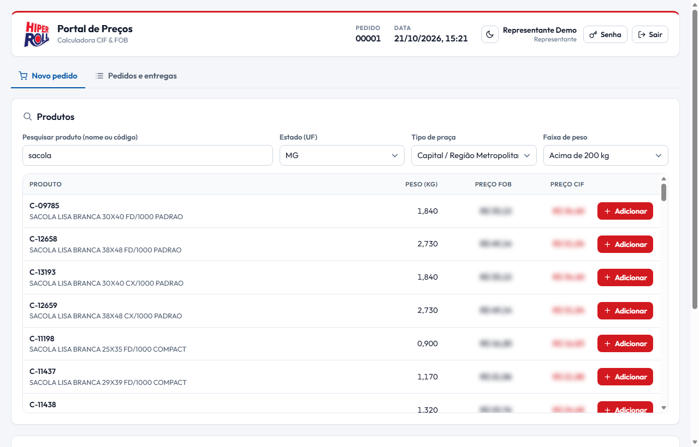
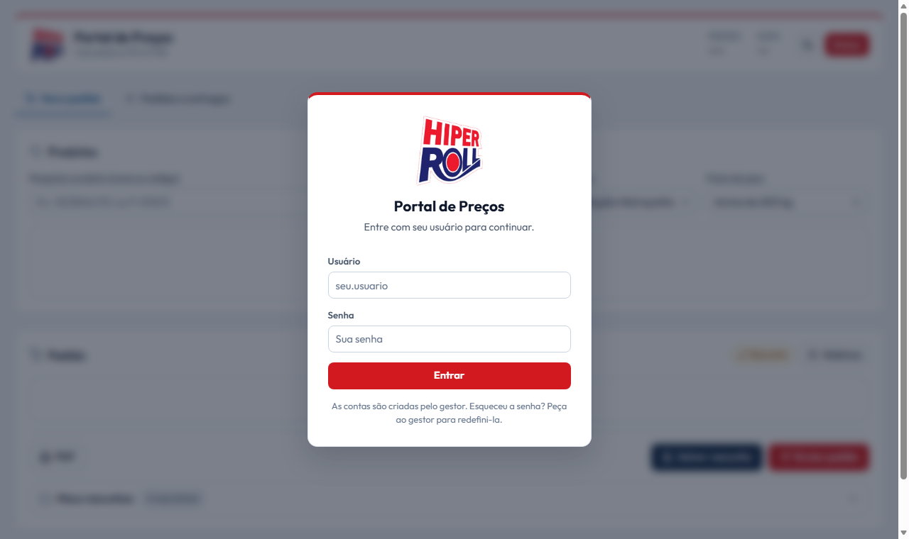
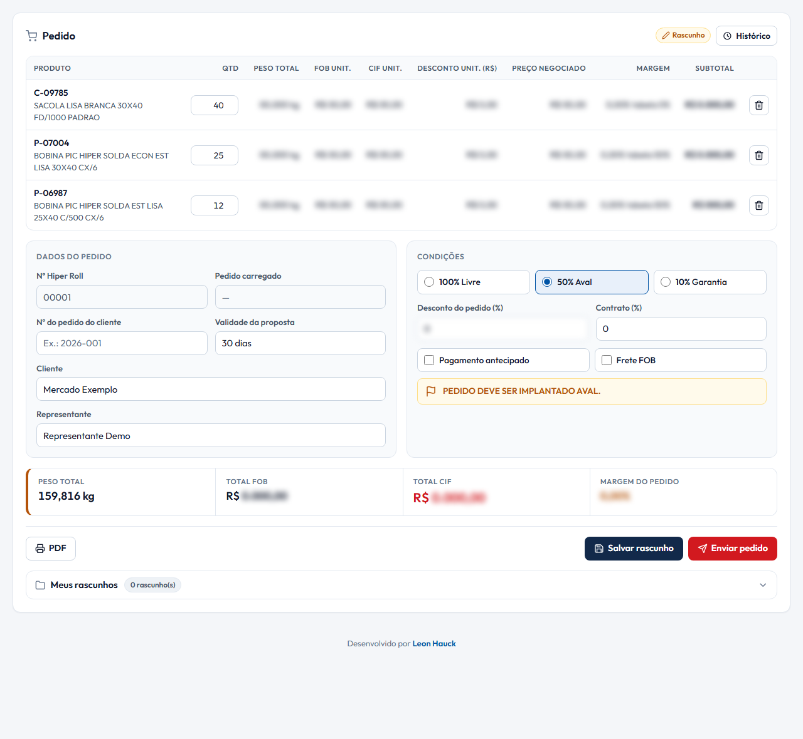
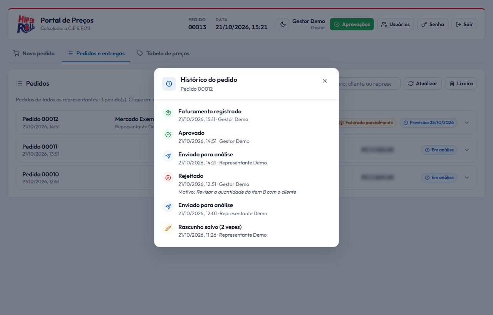
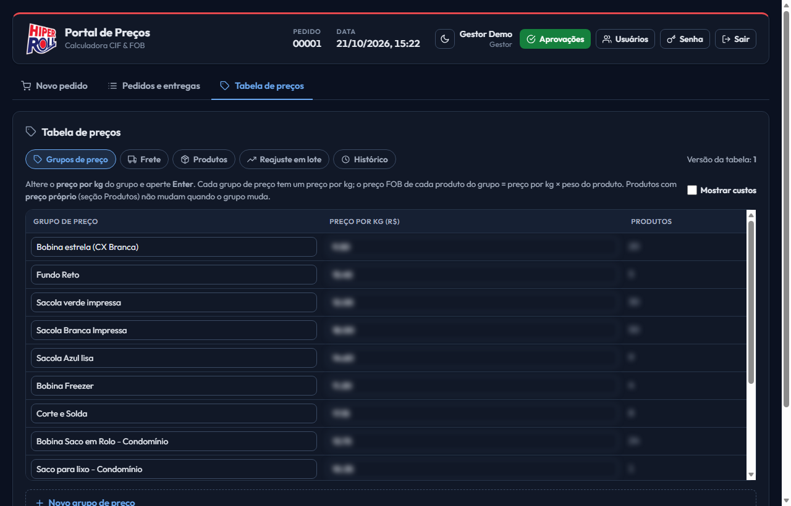
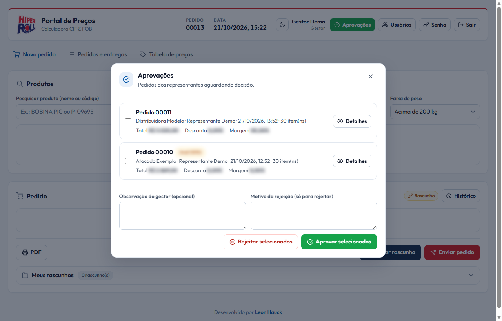
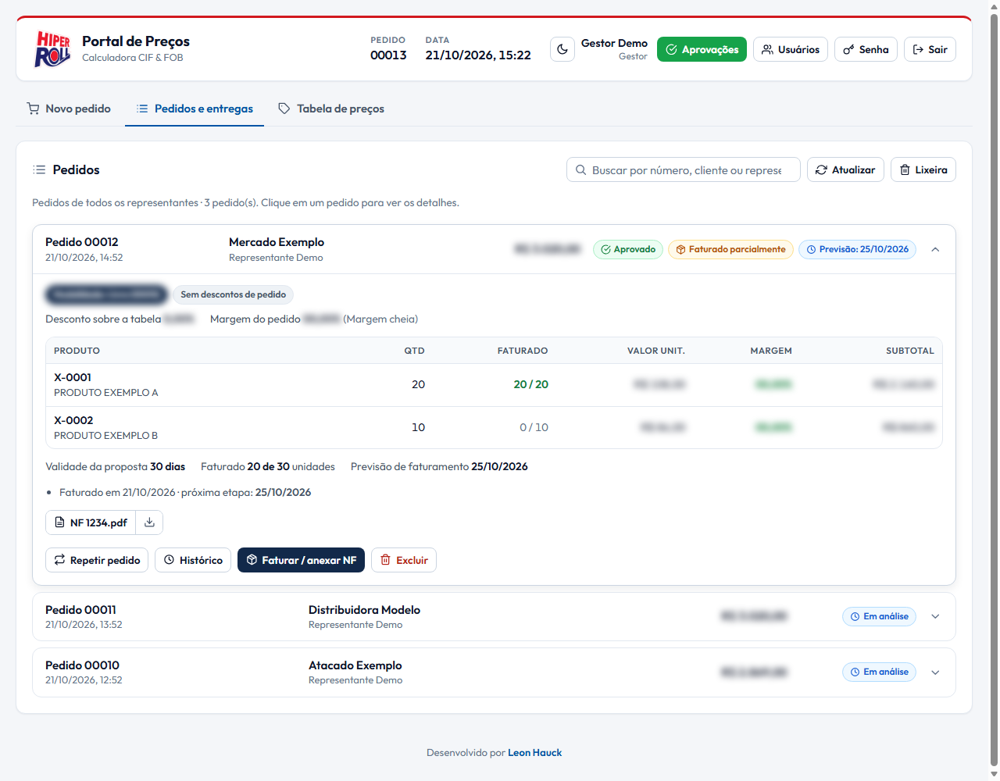
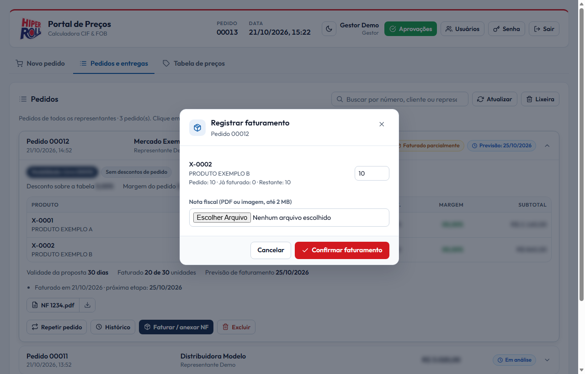
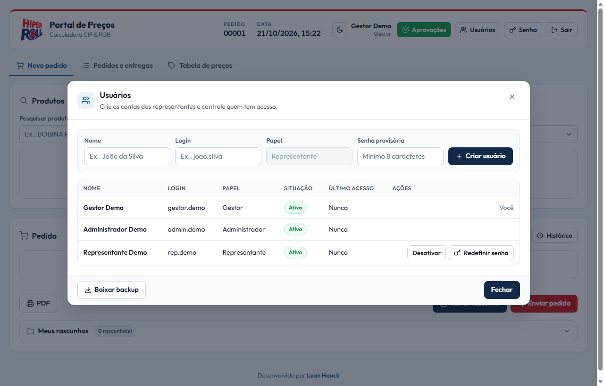
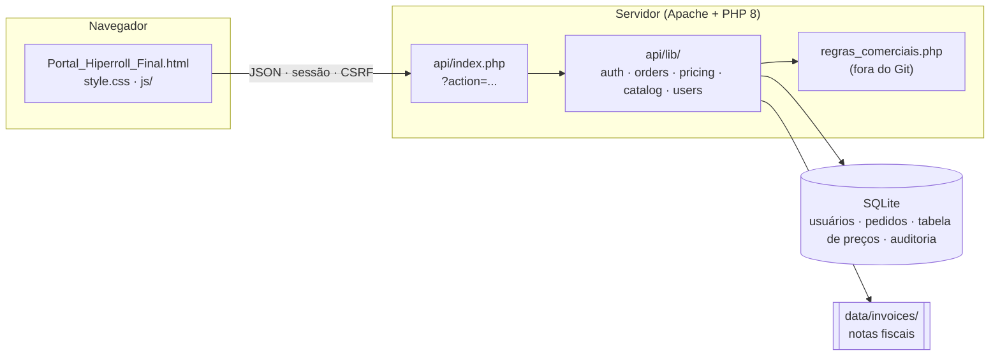

<div align="center">
  
  <h1>Portal de Preços Hiperroll</h1>
  <p>Precificação CIF/FOB, negociação e aprovação de pedidos para a equipe comercial da <strong>Hiperroll Embalagens</strong>.</p>
  <p>
    
    
    
    
    
  </p>
  <br />
  
  <p><sub>Consulta de preços com usuário de exemplo; os valores aparecem desfocados. Mais telas em <a href="#telas">Telas</a>.</sub></p>
</div>

---

## Sumário

- [Visão geral](#visão-geral)
- [Telas](#telas)
- [Arquitetura](#arquitetura)
- [Funcionalidades](#funcionalidades)
- [Perfis e permissões](#perfis-e-permissões)
- [Executar localmente](#executar-localmente)
- [Publicação na HostGator](#publicação-na-hostgator)
- [Regras comerciais](#regras-comerciais)
- [Dados e backup](#dados-e-backup)
- [Segurança](#segurança)
- [Manutenção da tabela de preços](#manutenção-da-tabela-de-preços)
- [Testes automatizados](#testes-automatizados)
- [Estrutura do projeto](#estrutura-do-projeto)
- [Limitações conhecidas](#limitações-conhecidas)
- [Licença e uso](#licença-e-uso)

## Visão geral

O Portal de Preços substitui planilhas e pedidos avulsos por um fluxo único: o representante consulta o preço, monta o pedido, negocia as condições e envia para aprovação; o gestor aprova, acompanha o faturamento e mantém a tabela de preços, que vale na hora para toda a equipe.

**Destaques**

- **Preço CIF e FOB na hora**, por estado, tipo de praça e faixa de peso, calculado a partir de custos, frete e peso de cada produto.
- **Política comercial aplicada pelo servidor**: modalidades, limites de desconto, justificativa obrigatória fora da política e bloqueio acima do teto.
- **Aprovação automática** dos pedidos que seguem a política e não pioram preço nem margem em relação ao último pedido aprovado do cliente.
- **Custos e margens protegidos**: o representante recebe apenas preços prontos; custo, frete e margem nunca chegam ao navegador dele.
- **Rastreabilidade completa**: histórico de cada pedido, histórico "de → para" de cada preço e versão da tabela gravada em cada pedido.
- **Sem etapa de build**: HTML, CSS e JavaScript puros, com um backend PHP + SQLite que roda em hospedagem compartilhada.

## Telas

Capturas feitas com usuários e clientes de exemplo. Preços, descontos e margens foram substituídos por zeros e desfocados (geradas por `tests/gerar_prints.ps1`).

| Login | Consulta de preços |
| :---: | :---: |
|  |  |
| Acesso individual para cada usuário. | Produto, estado, praça e peso do pedido definem o preço. |

| Montagem do pedido | Histórico do pedido |
| :---: | :---: |
|  |  |
| Itens, preço negociado, condições e totais em tempo real. | Quem salvou, enviou, aprovou, rejeitou e faturou, com data e hora. |

| Tabela de preços (tema escuro) |
| :---: |
|  |
| O gestor altera grupos de preço, fretes e produtos direto na tela. |

| Aprovações | Pedidos e entregas |
| :---: | :---: |
|  |  |
| Pedidos aguardando decisão, com os motivos da análise. | Situação, faturamento parcial e previsão da próxima entrega. |

| Registro de faturamento | Usuários |
| :---: | :---: |
|  |  |
| Quantidade faturada por item e nota fiscal anexada. | Criação de contas, desativação e redefinição de senhas. |

## Arquitetura



| Camada | Tecnologia | Responsabilidade |
|---|---|---|
| Interface | HTML5, CSS3 e JavaScript puro, um arquivo por assunto em `js/` | Telas, cálculo instantâneo enquanto o pedido é montado, tema claro/escuro |
| API | PHP 8, ponto de entrada único `api/index.php` | Autenticação, permissões, pedidos, tabela de preços, regras comerciais |
| Dados | SQLite (um arquivo) + pasta de notas fiscais | Usuários, pedidos, auditoria, tabela de preços versionada |
| PDF | [html2pdf.js](https://github.com/eKoopmans/html2pdf.js) via CDN | Proposta comercial |

**Princípios**

- **O servidor decide.** Permissões, preços e regras são recalculados no servidor a cada gravação; a tela apenas antecipa o resultado. Alterar o JavaScript no navegador não muda preço, desconto nem margem de um pedido.
- **Dados sensíveis fora do Git e do navegador.** Valores da política comercial, custos, banco e notas fiscais não são versionados, e o representante só recebe o que precisa para vender.
- **Publicação simples.** Não há dependências a instalar nem etapa de build: publicar é copiar os arquivos para a hospedagem.

## Funcionalidades

### Precificação

- Pesquisa de produtos por descrição, código e categoria.
- Seleção de UF e tipo de praça: Capital, Interior, Fluvial ou uma cidade com frete próprio (exibida pelo nome).
- **Faixa de peso automática**: o frete acompanha o peso total do pedido e os preços se ajustam sozinhos ao mudar de faixa. Pedidos abaixo da faixa mínima recebem um aviso e seguem para análise do gestor.
- **Atualização automática**: cada portal aberto confere a versão da tabela periodicamente; quando o gestor altera um preço, a consulta e o pedido aberto são atualizados.

### Pedidos e negociação

- Itens com quantidade ajustável e preço negociado por item, sincronizado com o desconto unitário.
- Condições do pedido: modalidade, desconto, contrato, pagamento antecipado e frete FOB, com o efeito de cada uma mostrado separadamente.
- Avisos da modalidade escolhida, visíveis para o representante e para o gestor.
- Pedidos fora da política só são enviados com justificativa; acima do desconto máximo o envio é bloqueado e um aviso aparece na tela.
- Dados do cliente com **CNPJ opcional e validado**, inclusive no formato alfanumérico.
- Rascunhos, repetição de pedidos anteriores e lixeira com restauração.
- **Preços sempre atualizados**: pedidos em montagem e rascunhos passam para a tabela em vigor, mantendo o desconto em R$ de cada item; pedidos enviados não mudam.
- **Pedido rejeitado**: o representante usa "Corrigir e reenviar"; os itens que já estavam no pedido mantêm o preço e o número é preservado.

### Aprovação e acompanhamento

- **Aprovação automática** quando o pedido está dentro da política, tem peso suficiente e não piora preço nem margem em relação ao último pedido aprovado do cliente (identificado pelo CNPJ ou, na falta dele, pelo nome). Para produtos que o cliente nunca comprou, a referência é o último pedido aprovado com o mesmo produto.
- Os demais pedidos vão ao gestor com os motivos da análise e uma comparação produto a produto.
- Aprovação ou rejeição com observação e motivo; pode haver mais de um gestor.
- **Histórico do pedido** vindo do registro de auditoria do servidor: rascunho, envio, aprovação, rejeição, faturamento, lixeira e restauração, com data e usuário.
- Faturamento parcial ou completo por item, com nota fiscal anexada e previsão do próximo faturamento.
- Numeração sequencial de cinco dígitos gerada pelo servidor. Na migração, o administrador define o próximo número para continuar a sequência do sistema anterior.

### Tabela de preços (gestor)

- Grupos de preço (custos, despesas e preço por kg), frete por UF e praça, e cadastro de produtos (grupo, peso, situação, preço próprio).
- Ações por categoria e reajuste percentual em lote, sempre com pré-visualização.
- Histórico "de → para" de cada alteração, com autor, data e motivo.
- Cada alteração gera uma nova **versão** da tabela, gravada nos pedidos.

> **Vocabulário:** *categoria* é a família do produto (usada para filtrar); *grupo de preço* é o conjunto de produtos que compartilha um preço por kg. No código, grupo de preço aparece como `costLines` / `cost_lines`.

### Proposta em PDF

- Proposta comercial com dados do pedido, itens, valores, condições e contrato. A margem só aparece no PDF do gestor e do administrador.

### Interface

- Tema claro e escuro, com detecção da preferência do sistema operacional e escolha salva no navegador.
- Layout responsivo, utilizável em telas de celular.
- Componentes padronizados (janelas, botões, avisos) e ícones SVG próprios.

## Perfis e permissões

As permissões são verificadas **no servidor** a cada ação; a interface apenas oculta o que o usuário não pode usar.

| Ação | Representante | Gestor | Administrador |
|---|:---:|:---:|:---:|
| Criar rascunhos e enviar os próprios pedidos | ✓ | ✓ | ✓ |
| Ver pedidos | os próprios | todos | os próprios |
| Aprovar, rejeitar e registrar faturamento | — | ✓ | — |
| Ver margens (produto e pedido) | — | ✓ | ✓ |
| Tabela de preços | — | edita | importa e consulta |
| Lixeira | os próprios | todos | os próprios |
| Excluir definitivamente | rascunhos e rejeitados próprios | qualquer pedido | rascunhos e rejeitados próprios |
| Gerenciar usuários | — | representantes | todas as contas |
| Definir o próximo número de pedido | — | — | ✓ |
| Baixar backup | — | ✓ | ✓ |

- Contas novas recebem uma **senha provisória**, trocada obrigatoriamente no primeiro acesso.
- O sistema impede a desativação do último gestor ativo.

## Executar localmente

### Requisitos

- PHP 8.0 ou superior com as extensões `pdo_sqlite` e `mbstring`.
- O arquivo `api/regras_comerciais.php` (ver [Regras comerciais](#regras-comerciais)).
- O `data.js` com a tabela inicial, até a tabela ser levada para o banco.

### Servidor local

```powershell
php -S localhost:8000
```

1. Acesse `http://localhost:8000/setup.php`, confira a verificação do ambiente e crie as contas do gestor e do administrador.
2. Use o portal em `http://localhost:8000/Portal_Hiperroll_Final.html`.

Abrir o HTML diretamente (`file://`) mostra apenas a tela de login com erro de conexão, porque o portal depende da API.

### Modo demonstração (sem PHP)

A pasta `demo/` existe apenas na máquina de desenvolvimento (está no `.gitignore`). O arquivo `demo/index.html` abre com dois cliques e usa `demo/demo_api.js`, que simula a API no navegador com as mesmas regras do servidor.

- Uma barra no rodapé alterna entre usuários de exemplo (que aceitam qualquer senha) e permite zerar os dados.
- Os dados ficam no `localStorage` do navegador; nada é enviado para fora.
- Serve para apresentar e treinar; **não testa o PHP** e não oferece segurança real.
- Depois de alterar o `Portal_Hiperroll_Final.html`, regenere a cópia com `powershell -File demo\gerar_demo.ps1`.

## Publicação na HostGator

1. **PHP**: em cPanel → *MultiPHP Manager*, selecione PHP 8.1 ou superior. Em *Select PHP Version → Extensions*, confirme `pdo_sqlite` e `mbstring`.
2. **HTTPS**: em cPanel → *SSL/TLS Status*, ative o AutoSSL e descomente o bloco "forçar HTTPS" no `.htaccess` da raiz.
3. **Arquivos**: envie para uma pasta do `public_html` (por exemplo, `public_html/portal/`):
   - `Portal_Hiperroll_Final.html`, `style.css`, `setup.php`, `.htaccess`, `logo.png`, `logo-hiperroll.png`, `logo-transparent.png`;
   - as pastas `js/`, `api/` e `data/`;
   - os arquivos que **não estão no repositório**: `api/regras_comerciais.php` e `data.js`.

   Não envie `tests/`, `docs/`, `demo/`, `scratch/`, planilhas nem o `README.md`. Se forem enviados por engano, o `.htaccess` bloqueia o acesso.
4. **Banco fora da pasta pública** (recomendado): copie `api/config.local.example.php` para `api/config.local.php` e aponte `db_path` para um caminho como `/home/SEU_USUARIO/portal_data/portal.sqlite`.
5. **Primeiro acesso**: abra `https://seudominio.com.br/portal/setup.php`, confira a verificação e crie as contas do gestor e do administrador. A página se desativa depois disso.
6. **Equipe**: o gestor cria cada representante em **Usuários**, com senha provisória.
7. **Tabela de preços**: na primeira vez que o gestor abre a aba **Tabela de preços**, o conteúdo do `data.js` é copiado para o banco sem alterar nenhum preço. A partir daí, o `data.js` pode ser removido do servidor.

> Ao publicar uma nova versão, envie juntos os arquivos PHP, os arquivos de `js/` e o HTML. O HTML carrega os scripts com um parâmetro de versão (`?v=`) para que os navegadores baixem o JavaScript novo.

## Regras comerciais

Os valores da política comercial (modalidades, limites de desconto, percentuais e pontos de alerta) **não fazem parte do repositório** nem deste documento. Eles ficam em `api/regras_comerciais.php`, que está no `.gitignore` e é recusado pelo hook de pre-commit.

| Arquivo | Conteúdo |
|---|---|
| `api/regras_comerciais.example.php` | Modelo versionado, com números fictícios |
| `api/regras_comerciais.php` | Valores reais (somente na máquina de desenvolvimento e no servidor) |

Para instalar em outra máquina, copie o modelo para `api/regras_comerciais.php` e preencha os valores reais.

- O servidor carrega e valida as regras em `pricing_rules()` (`api/lib/pricing.php`).
- A interface recebe as regras junto com a sessão, depois do login (`pricing_rules_for_client()` → `applyServerRules()` em `js/regras.js`). O representante não recebe os parâmetros de margem.
- Para mudar uma regra, basta alterar o `regras_comerciais.php` do servidor.

As **fórmulas** existem nos dois lados, porque a tela calcula enquanto o pedido é montado, mas quem decide é sempre o servidor:

| Cálculo | Interface | Servidor |
|---|---|---|
| Totais, descontos e margem do pedido | `calculateOrderTotals()` em `js/regras.js` | `calculate_order_totals()` em `api/lib/pricing.php` |
| Preço FOB/CIF do item | `computeItemPrices()` em `js/catalogo.js` (gestor e administrador) | `server_item_prices()` em `api/lib/catalog.php` |

## Dados e backup

- **Banco**: usuários, pedidos, lixeira, numeração, auditoria e tabela de preços ficam em um único arquivo SQLite (`data/portal.sqlite` por padrão), criado automaticamente.
- **Numeração**: o número do pedido é gerado pelo servidor na primeira gravação, sem risco de duplicidade. O número exibido antes disso é uma previsão.
- **Notas fiscais**: PDF, PNG, JPG, WEBP ou GIF de até 2 MB, gravados em `invoices/` ao lado do banco. O tipo é conferido pelo conteúdo do arquivo, e o download passa pela API (`orders.invoice`), que só entrega a nota ao dono do pedido e ao gestor.
- **Tabela de preços**: versionada; cada alteração incrementa a versão, que é gravada em cada pedido.
- **Backup pela interface**: em **Usuários → Baixar backup**, o gestor ou o administrador baixa um JSON com pedidos, notas e usuários (sem senhas).
- **Backup completo**: copie o arquivo `.sqlite` e a pasta `invoices/` pelo Gerenciador de Arquivos do cPanel; para restaurar, substitua-os.
- Apenas preferências de interface, como o tema, ficam no navegador.

## Segurança

**Autenticação e sessão**

- Senhas armazenadas com `password_hash()` (bcrypt); login limitado a 5 tentativas a cada 15 minutos por usuário e IP.
- Sessão em cookie `HttpOnly`/`SameSite`, renovada no login; toda alteração exige token CSRF.

**Integridade comercial**

- Preços, descontos e margens são recalculados no servidor a partir do banco (`api/lib/pricing.php`, `api/lib/catalog.php`).
- Pedidos montados com uma versão antiga da tabela são recusados no envio até que os novos preços sejam revisados.
- **Custos e fretes não chegam ao navegador do representante**: ele recebe apenas produtos e regiões, e solicita ao servidor os preços prontos de uma região por vez (`pricing.prices` → `region_prices()` em `api/lib/catalog.php`). Nem as ferramentas do desenvolvedor do navegador (F12) mostram custo, frete ou margem. Gestor e administrador recebem a tabela completa.

**Navegador**

- Todo texto informado por usuários passa por `escapeHtml()` antes de ser exibido, com teste automatizado.
- **Content Security Policy** definida no `<meta>` do HTML e no `.htaccess` (as duas devem permanecer iguais; o `.htaccess` acrescenta `frame-ancestors`). Só é executado JavaScript do próprio site e da biblioteca de PDF. Por isso o HTML não usa `onclick=`, scripts embutidos nem `style=""`: os botões declaram `data-action="nomeDaAcao"`, ligado à função correspondente em `js/acoes.js`.
- `style-src` mantém `'unsafe-inline'` porque a biblioteca de PDF aplica estilos inline; os scripts continuam totalmente restritos.

**Servidor e repositório**

- O `.htaccess` bloqueia o acesso ao banco, às planilhas, aos scripts de manutenção, aos backups e a arquivos ocultos; a pasta de dados recusa qualquer acesso direto.
- Configuração local, regras comerciais, banco, notas fiscais, `data.js`, planilhas e CSVs estão no `.gitignore`, e o hook `.githooks/pre-commit` recusa o commit se algum deles for adicionado.
- Credenciais presentes em versões do código anteriores a outubro de 2026 permanecem no histórico público do repositório e **não devem ser reutilizadas**.

## Manutenção da tabela de preços

A manutenção é feita pelo gestor na aba **Tabela de preços**, direto na tela, sem importar arquivos:

| Seção | O que permite |
|---|---|
| Grupos de preço | Preço por kg de cada grupo; "Mostrar custos" exibe custo, despesas, total e markup |
| Frete | Valores por UF, praça e faixa de peso; inclusão e remoção de praças |
| Produtos | Descrição, grupo, peso, situação e preço FOB próprio; edição de vários produtos e gravação em lote; filtro por categorias com ações para todos os listados |
| Reajuste em lote | Percentual sobre grupos (preço e custos, só preço ou só custos) ou sobre o frete de UFs escolhidas, com pré-visualização |
| Histórico | Autor, data, valor anterior, valor novo e motivo de cada alteração |

Produtos com preço próprio não acompanham os reajustes do grupo; "usar grupo" desfaz o preço próprio.

### Atualização do `data.js` (antes da importação)

Enquanto a tabela ainda não foi levada para o banco, o script `scratch/update_data.ps1` atualiza o bloco de produtos do `data.js` a partir da planilha `.xlsx`, sem Excel e sem exportar CSV. As colunas são localizadas pelo nome do cabeçalho, então colunas novas ou fora de ordem não afetam a leitura.

```powershell
# Usa a planilha de produtos mais recente da pasta do projeto
powershell -File scratch\update_data.ps1

# Ou indica a planilha pelo nome
powershell -File scratch\update_data.ps1 -Xlsx "NOME DA PLANILHA.xlsx"
```

O script funciona em qualquer Windows com o PowerShell padrão. Ao final, informa a planilha usada e os produtos que entraram e saíram; se houver mais de uma planilha com a mesma data, pede o nome em `-Xlsx`.

## Testes automatizados

Os testes abrem o portal no Microsoft Edge em modo headless, conversando com uma API simulada (`tests/api_simulada.js`) que segue o mesmo contrato do `api/index.php`. São cobertos os cenários de usuário anônimo, representante, gestor, administrador e o modo demonstração.

```powershell
# Executa todos os cenários
powershell -ExecutionPolicy Bypass -File tests\rodar_testes.ps1

# Executa um cenário específico
powershell -ExecutionPolicy Bypass -File tests\rodar_testes.ps1 -Modos gestor

# Regenera as imagens deste README
powershell -ExecutionPolicy Bypass -File tests\gerar_prints.ps1
```

- Requer o `data.js` na pasta do projeto e o Microsoft Edge instalado. Os resultados ficam em `tests/resultados/` (fora do Git).
- A API simulada usa regras comerciais fictícias, e os resultados esperados são calculados a partir delas.
- Os testes validam a interface e as regras no navegador; **o PHP não é executado** nesta etapa.

## Estrutura do projeto

```text
Portal_Precos_Hiperroll/
├── Portal_Hiperroll_Final.html   # Página principal
├── style.css                     # Temas claro/escuro, componentes e telas
├── js/                           # Interface, um arquivo por assunto (ordem de carga definida no HTML)
│   ├── tema.js                   #   aplica o tema antes da página aparecer
│   ├── regras.js                 #   regras recebidas do servidor, cálculos e utilitários
│   ├── servidor.js               #   comunicação com a API, sessão e pedidos em memória
│   ├── inicio.js                 #   inicialização
│   ├── catalogo.js               #   tabela de preços em uso, preços FOB/CIF e revisão de preços
│   ├── pedido.js                 #   tela Novo pedido
│   ├── pdf.js                    #   proposta em PDF
│   ├── historico-pedido.js       #   linha do tempo do pedido e backup
│   ├── login-usuarios.js         #   login, senha e usuários
│   ├── rascunhos-envio.js        #   rascunhos, envio, notas fiscais, repetição e exclusão
│   ├── lixeira.js                #   lixeira
│   ├── gestor.js                 #   aprovações
│   ├── historico-faturamento.js  #   abas, lista de pedidos e faturamento
│   ├── tabela-precos.js          #   aba Tabela de preços
│   └── acoes.js                  #   liga data-action / data-change / data-input às funções
├── api/
│   ├── index.php                 # Ponto de entrada único da API (?action=...)
│   ├── data.php                  # Entrega o data.js apenas a gestor e administrador
│   ├── config.php                # Configuração padrão
│   ├── config.local.example.php  # Modelo de configuração da hospedagem
│   ├── regras_comerciais.example.php  # Modelo das regras comerciais
│   └── lib/                      # auth, core, db, orders, pricing, catalog, users
├── setup.php                     # Configuração inicial (gestor e administrador)
├── .htaccess                     # CSP e bloqueio de arquivos sensíveis
├── .githooks/pre-commit          # Impede o commit de arquivos sensíveis
├── data/                         # Banco SQLite e notas fiscais (gerados; fora do Git)
├── docs/screenshots/             # Imagens deste README
├── scratch/                      # Script de atualização do data.js
├── tests/                        # Testes automatizados e geração das imagens
├── logo-hiperroll.png            # Logo do cabeçalho e favicon
└── logo.png                      # Logo usado no PDF
```

## Limitações conhecidas

- Antes da importação da tabela para o banco, a ligação entre produto e grupo de preço vem de regras no código (`LEGACY_CATEGORY_LINES` em `js/catalogo.js` e `getCategoryMatch()` em `js/pedido.js`). Depois da importação, ela é editada na aba Tabela de preços.
- A nota fiscal é anexada manualmente no registro de faturamento; a integração com o sistema de gestão da empresa está prevista para uma etapa futura.
- O backend é validado na hospedagem; os testes automatizados cobrem a interface com uma API simulada.

## Licença e uso

Projeto de uso interno da operação comercial da Hiperroll Embalagens. O código está disponível para consulta; para reutilizá-lo em outro contexto, remova nomes, marcas, logotipos e documentos da Hiperroll.

---

<div align="center">
  <sub>Desenvolvido por <a href="https://www.linkedin.com/in/leon-hauck/">Leon Hauck</a> para a operação comercial da Hiperroll Embalagens.</sub>
</div>
